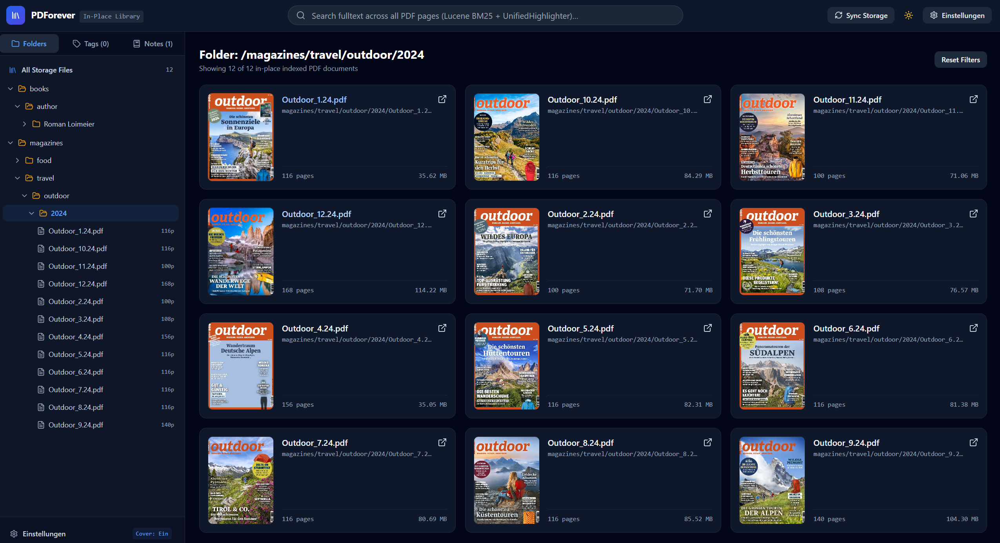

# PDForever — In-Place PDF Document Management & Excerpting System

**PDForever** is a self-hosted, high-performance Document Management & Excerpting System (`Lesezettel`) designed for personal libraries of 1,000+ PDFs (books, magazines, papers).

Built around **in-place storage**, PDForever indexes and streams existing PDFs directly from `./storage` without copying, moving, or renaming your files.



---

## Architecture Highlights

1. **In-Place Filesystem Ingestion & Sync (`DirectoryScannerService` & `FileWatcherService`)**
   - Configurable root directory via `library.root-dir` (defaults to `./storage`).
   - **Startup Reconciliation**: Traverses `./storage`, indexes new PDFs, re-indexes modified PDFs by comparing filesystem `lastModified` timestamps & byte sizes, and marks removed files as `is_deleted = true` while purging them from Lucene.
   - **Runtime `WatchService` with Debouncing**: Recursively monitors `./storage` for created, modified, and deleted PDFs. New/modified files are debounced with a 2-second file-size stability check (`library.debounce-ms: 2000`) so large files copying into `./storage` are never parsed prematurely.
   - **Portable Relative Paths**: Stores all paths relative to `library.root-dir` with normalized `/` separators.

2. **Page-Level Embedded Apache Lucene 9.x Search (`LuceneIndexService` & `SearchService`)**
   - Indexes **each PDF page as a separate Lucene document** (`docId`, `relPath`, `pageNumber` as `IntPoint` & `StoredField`, and `content` as `TextField` with TermVectors, Positions, and Offsets).
   - Queries use `StandardAnalyzer` with `BM25Similarity` scoring and `UnifiedHighlighter` to generate `<mark>`-highlighted contextual snippets grouped by document.

3. **SQLite (WAL Mode) & Spring Data JPA**
   - Entities: `Document`, `Tag`, and `ReadingNote` (`Lesezettel` with normalized relative bounding box coordinates `{x1, y1, x2, y2}` in `0.0–1.0`).

4. **HTTP 206 Byte-Range Streaming (`DocumentController`)**
   - `GET /api/documents/{id}/stream` streams 1–2 MB chunks on demand using Spring's `ResourceRegion` (`206 Partial Content`, `Accept-Ranges: bytes`) so 200 MB+ PDFs load instantaneously in Mozilla `PDF.js` without loading the full file into RAM.

5. **3-Panel Split-View Frontend (Vite + React + TypeScript + Tailwind CSS + `pdfjs-dist`)**
   - **Left Sidebar**: Directory Tree Explorer, Tag Browser & Creator, and Global Reading Notes Search.
   - **Top Bar**: Instant Lucene Search with auto-suggest snippet highlighting, Storage Sync trigger, and Dark/Light Theme toggle.
   - **Main Content Area**: PDF.js Continuous Scroll & Single-Page Reader with `TextLayer` selection hook (`Add Reading Note`), normalized `0.0–1.0` coordinate capture, and interactive highlight overlays.

---

## Running PDForever

### 1. Backend (Java 21 + Spring Boot 3.3)
```bash
mvn spring-boot:run
```
The backend listens on `http://localhost:8080` and automatically indexes `./storage` into `./data/pdforever.db` (SQLite WAL) and `./data/lucene-index`.

### 2. Frontend (Vite + React + TypeScript)
```bash
cd frontend
npm install
npm run dev
```
Or build static assets directly into Spring Boot's `src/main/resources/static`:
```bash
cd frontend
npm run build
```

